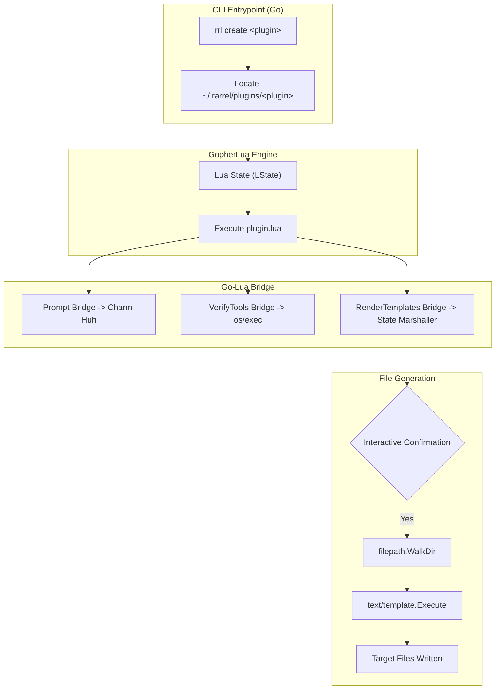

# Architecture & Internals

This document details the internal design and operational pipeline of **Rarrel** (`rrl`).

---

## Architectural Philosophy

Rarrel is designed around three core principles:
1. **Separation of Concerns**: User interaction and business logic belong in scriptable plugins (Lua); heavy lifting, file I/O, terminal rendering, and system checks belong in compiled, performant code (Go).
2. **Zero-Overhead Extensibility**: Creating a new generator should not require a Go compiler, recompiling the CLI, or managing complex npm/python package dependencies.
3. **Safety & Predictability**: File generation must be non-destructive by default, confirming target actions with the user before committing to disk.

---

## System Architecture Diagram

---

## Execution Lifecycle

When you invoke `rrl create <plugin>`, Rarrel progresses through several discrete phases:

### 1. Command Routing (`internal/cmd`)
- Built with [Cobra](https://github.com/spf13/cobra).
- Resolves the requested plugin name argument.
- Invokes `lua.LoadLua(plugin)` from [`internal/lua/lua.go`].

### 2. Path Resolution & Environment Setup (`internal/config`)
- Discovers user's home directory via `os.UserHomeDir()`.
- Constructs paths:
  - Plugin Path: `~/.rarrel/plugins/<plugin>/plugin.lua`
  - Plugin Root: `~/.rarrel/plugins/<plugin>`
- Initializes a new `gopher-lua` state (`lua.NewState()`).
- Binds global helpers:
  - `PLUGIN_DIR`: Points to the plugin directory.
  - Updates `package.path` so Lua scripts can `require()` sibling files.

### 3. Go API Exposure
Rarrel registers native Go functions into the Lua runtime:
- `prompt` $\rightarrow$ `lua.Prompt`
- `verifyTools` $\rightarrow$ `tools.VerifyTools`
- `renderTemplates` $\rightarrow$ `templates.RenderTemplate`

### 4. Interactive Prompts (`internal/lua/lua.go`)
- Uses [Charm's Huh](https://github.com/charmbracelet/huh) to render responsive terminal inputs.
- Handles default fallbacks and returns responses back into Lua as strings.

### 5. Dependency Validation (`internal/lua/tools`)
- Resolves executable binaries using `exec.LookPath`.
- Executes commands with specified flags (e.g. `go version`) to capture version strings.
- Parses output with regular expressions (`\d+(?:\.\d+){1,2}`).
- Compares semantic versions and prints ANSI colored status output (`✓` / `✘`).

### 6. State Marshalling & Confirmation (`internal/lua/templates`)
- Traverses the Lua global table (`L.G.Global`).
- Excludes functions and built-in objects.
- Converts Lua tables and primitives to Go types (`map[string]any`, `[]any`, `string`, `float64`, `bool`).
- Prompts user confirmation via `huh.NewConfirm()`.

### 7. Recursive Template Generation (`internal/generate`)
- Recursively walks the template directory via `filepath.WalkDir`.
- Ignores non-`.tmpl` files.
- Preserves relative paths and strips `.tmpl` suffixes.
- Ensures parent directories exist using `os.MkdirAll(..., 0755)`.
- Compiles and executes templates using Go's `text/template` engine.
