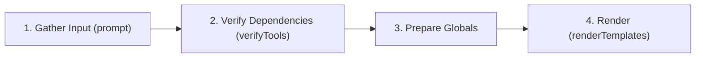

# Plugin & Template Authoring Guide

This guide walks you through building custom project generator plugins for **Rarrel** (`rrl`).

---

## Table of Contents

- [Plugin Concept](#plugin-concept)
- [Plugin Directory Layout](#plugin-directory-layout)
- [Writing `plugin.lua`](#writing-pluginlua)
- [Template Engine Guide (`.tmpl`)](#template-engine-guide-tmpl)
  - [Variable Interpolation](#variable-interpolation)
  - [Conditionals](#conditionals)
  - [Loops & Arrays](#loops--arrays)
  - [Directory Hierarchy Preservation](#directory-hierarchy-preservation)
- [End-to-End Tutorial: Creating a Rust Plugin](#end-to-end-tutorial-creating-a-rust-plugin)
  - [Step 1: Set up the Directory](#step-1-set-up-the-directory)
  - [Step 2: Implement `plugin.lua`](#step-2-implement-pluginlua)
  - [Step 3: Define `.tmpl` Files](#step-3-define-tmpl-files)
  - [Step 4: Test Your Plugin](#step-4-test-your-plugin)
- [Sharing and Managing Plugins](#sharing-and-managing-plugins)

---

## Plugin Concept

A Rarrel plugin is a self-contained directory containing:
1. **A Lua script (`plugin.lua`)**: Collects user input via interactive prompts, verifies system tool dependencies, and configures template data.
2. **Template files (`templates/**/*.tmpl`)**: Go `text/template` files that will be rendered into the final project structure.

---

## Plugin Directory Layout

Plugins are discovered automatically inside `~/.rarrel/plugins/`:

```
~/.rarrel/plugins/
└── <plugin_name>/
    ├── plugin.lua            # Entrypoint script
    └── templates/            # Directory containing all template files
        ├── Cargo.toml.tmpl
        ├── README.md.tmpl
        └── src/
            └── main.rs.tmpl
```

---

## Writing `plugin.lua`

Your `plugin.lua` orchestrates the entire generation workflow.

A typical script follows this lifecycle:



### Script Example

```lua
print("\nLoading plugin...\n")

-- 1. Gather User Inputs
local pwd = io.popen("pwd"):read("*l")
local basename = pwd:match("([^/]+)/*$")

ProjectName = prompt("Enter Project Name:", "? ", basename)

-- Determine output destination
local dest
if ProjectName == basename then
    dest = "./"
else
    dest = ProjectName
end

Author = prompt("Author Name:", "? ", os.getenv("USER") or "Anonymous")

-- 2. Verify System Dependencies
Tools = {
    {
        name = "cargo",
        required = true,
        version = "1.70",
        version_arg = "--version"
    },
    {
        name = "git",
        required = true,
        version_arg = "--version"
    }
}

verifyTools(Tools)

-- 3. Render Templates
renderTemplates("./templates", dest)
```

> [!TIP]
> Variables defined as **global** (e.g. `ProjectName`, `Author`, `Tools`) are automatically collected and exposed to `.tmpl` files. Use `local` for variables you do not wish to expose to templates.

---

## Template Engine Guide (`.tmpl`)

Rarrel parses templates using Go's standard [`text/template`](https://pkg.go.dev/text/template) package.

### File Naming Convention

- Only files ending with `.tmpl` are processed and rendered.
- When rendered, the `.tmpl` suffix is automatically removed:
  - `main.go.tmpl` $\rightarrow$ `main.go`
  - `config/settings.json.tmpl` $\rightarrow$ `config/settings.json`
- Non-`.tmpl` files inside the template folder are ignored during generation.

---

### Variable Interpolation

Access top-level Lua global variables directly with dot notation `{{.VariableName}}`:

```gotemplate
# {{.ProjectName}}

Author: {{.Author}}
```

---

### Conditionals

Conditionally generate code blocks based on Lua booleans or string checks:

```gotemplate
{{if .EnableDocker}}
FROM golang:1.24-alpine
WORKDIR /app
COPY . .
RUN go build -o server .
CMD ["./server"]
{{end}}
```

---

### Loops & Arrays

Iterate over Lua array tables:

```gotemplate
### Installed Tools:
{{range .Tools}}
- {{.name}} (required: {{.required}})
{{end}}
```

Accessing a specific index in an array:

```gotemplate
Minimum required version: {{(index .Tools 0).version}}
```

---

### Directory Hierarchy Preservation

Rarrel preserves arbitrary directory depths. If your template folder contains:

```
templates/
└── internal/
    └── server/
        └── http.go.tmpl
```

Rarrel will automatically create `<destDir>/internal/server/` and output `http.go`.

---

## End-to-End Tutorial: Creating a Rust Plugin

Let's build a complete plugin called `rust_starter`.

### Step 1: Set up the Directory

```bash
mkdir -p ~/.rarrel/plugins/rust_starter/templates/src
```

### Step 2: Implement `plugin.lua`

Create `~/.rarrel/plugins/rust_starter/plugin.lua`:

```lua
print("\n=== Rust Starter Generator ===\n")

local pwd = io.popen("pwd"):read("*l")
local basename = pwd:match("([^/]+)/*$")

ProjectName = prompt("Enter Project Name:", "? ", basename)

local dest
if ProjectName == basename then
    dest = "./"
else
    dest = ProjectName
end

Edition = prompt("Rust Edition (2021 / 2024):", "? ", "2021")
License = prompt("Project License:", "? ", "MIT")

Tools = {
    {
        name = "cargo",
        required = true,
        version = "1.75",
        version_arg = "--version"
    },
    {
        name = "rustc",
        required = true,
        version_arg = "--version"
    }
}

verifyTools(Tools)

renderTemplates("./templates", dest)
```

### Step 3: Define `.tmpl` Files

#### `~/.rarrel/plugins/rust_starter/templates/Cargo.toml.tmpl`

```gotemplate
[package]
name = "{{.ProjectName}}"
version = "0.1.0"
edition = "{{.Edition}}"
license = "{{.License}}"

[dependencies]
```

#### `~/.rarrel/plugins/rust_starter/templates/src/main.rs.tmpl`

```gotemplate
fn main() {
    println!("Hello from {{.ProjectName}}!");
}
```

#### `~/.rarrel/plugins/rust_starter/templates/README.md.tmpl`

```gotemplate
# {{.ProjectName}}

Scaffolded with [Rarrel](https://github.com/piyushdugawa/rarrel).

## Build & Run

```bash
cargo run
```
```

### Step 4: Test Your Plugin

Run the generator from any directory:

```bash
rrl create rust_starter
```

Rarrel prompts for the project configuration, validates `cargo` and `rustc`, asks for confirmation, and creates the Rust project files!

---

## Sharing and Managing Plugins

Because plugins are standalone folders with simple Lua and `.tmpl` files, you can easily share and version-control them:

```bash
# Clone a team or community plugin into your plugins directory
git clone https://github.com/example/rarrel-plugin-react.git ~/.rarrel/plugins/react
```
